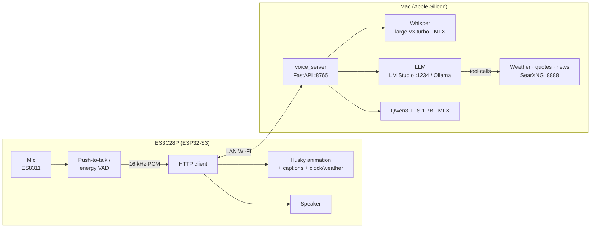

# XiaoQi 小奇 · A Fully Local AI Voice Chatbot on ESP32-S3

**English** | [中文](README.zh-CN.md)

A cartoon husky that changes expression as you talk, living on a 2.8" ESP32-S3 touch screen. Say "Xiǎoqí Xiǎoqí" (小奇小奇) to chat, ask about the weather, stock quotes or tech news. Speech recognition, the LLM, speech synthesis and web search **all run on your own Mac**: no cloud AI service, no API keys.

<p align="center">
  
  <br>
  
  
</p>

> The assistant is tuned for Mandarin Chinese (wake word, prompts, voice). It understands English and mixed Chinese/English speech; see [Configuration](docs/en/configuration.md) to change the prompt or voice.

## Features

- **Two ways to talk**: HOLD = push-to-talk on the screen; AUTO = hands-free with the wake word "小奇小奇" (wake word and question in one breath works too), plus an 8-second follow-up window with no wake word needed
- **An expressive husky**: three skins (chibi / pixel / cyber) × 19 frames; blinks and gets sleepy when idle, perks its ears while listening, shows a question mark while thinking, moves its mouth with the audio
- **Emotion-aware**: the LLM tags each reply (happy / surprised / sad / shy / smug / calm); both the face and the **tone of voice** follow
- **Chinese + English speech recognition**: Whisper large-v3-turbo on MLX, ~0.2 s per utterance
- **Natural Chinese voice**: Qwen3-TTS 1.7B with per-emotion delivery; Piper as a faster fallback
- **Live data**: weather (Open-Meteo), stocks / indices (Tencent quotes) and tech news (RSS) through dedicated tools for exact numbers; everything else through a local SearXNG; no API keys
- **Clock & weather card** on the idle screen (NTP + Open-Meteo, refreshed every 15 min)
- **Multi-turn memory**, Wi-Fi and battery indicators, and a 3D-printable desk enclosure (STL and Bambu slice files included)

<p align="center">
  <br>
  
</p>

## How it works



One turn: the board records → Whisper transcribes on the Mac → (in AUTO mode, check for the wake word) → the LLM answers, calling weather / quote / news / search tools when needed, and picks an emotion → Qwen3-TTS speaks it in that tone → the board shows the caption, switches the face and plays the audio. Details: [Architecture](docs/en/architecture.md).

## Hardware

| Part | Notes |
|---|---|
| **LCDWIKI ES3C28P** | ESP32-S3R8 (8 MB PSRAM) + 16 MB flash, 2.8" ILI9341V 320×240 IPS, FT6336G capacitive touch, ES8311 codec + on-board MEMS mic |
| Speaker | 8 Ω 1–2 W on the SPEAKER port, e.g. a 40×28×10 mm oval speaker |
| Li-ion battery (optional) | 3.7 V single-cell 103450 (34×50×10 mm), **1.25 mm 2-pin plug**, on the BAT port, charged over USB-C |
| Slide switch (optional) | SS12D00 in series with the battery's positive lead |
| Enclosure (optional) | [enclosure/](enclosure/README.md): two PLA parts, ~77 min, 4 × M3×25 countersunk self-tapping screws |

Bill of materials, wiring diagram, pinout and gotchas: [Hardware](docs/en/hardware.md).

## Quick start

You need an Apple Silicon Mac (32 GB RAM or more recommended), [Homebrew](https://brew.sh), [LM Studio](https://lmstudio.ai) (or Ollama), and the board on a USB-C data cable.

1. **LLM**: in LM Studio, download a chat model with tool-calling support (a fast MoE such as Qwen3-30B-A3B Instruct is recommended), load it, and click Start Server on the Developer tab (default `http://127.0.0.1:1234`).
2. **One-command install** (dependencies, models, local search, config files, firmware build and flash):

   ```bash
   git clone https://github.com/syu-lk4b/esp32-chatbot-local.git xiaoqi && cd xiaoqi
   ./install.sh            # prompts for Wi-Fi (2.4 GHz only), model and your city
   ```

   Options: `--no-flash` (build only), `--autostart` (start the backend at login), `--skip-models`. Safe to re-run; existing config is kept.

3. **Start the backend**:

   ```bash
   ./start.sh        # SearXNG + voice server; ./start.sh stop to stop
   ```

4. **Talk**: switch to **AUTO** (top right) and say "小奇小奇，明天会下雨吗？" ("XiaoQi, will it rain tomorrow?"), or hold the screen in **HOLD** mode.

Step-by-step details: [Running the services on a Mac](docs/en/mac-setup.md) · [Flashing](docs/en/flashing.md)

> Reserve the Mac's IP in your router's DHCP settings: the board finds the Mac at the IP recorded during install.

## Usage

| Control | Action |
|---|---|
| **HOLD / AUTO** (top right) | push-to-talk vs. wake-word mode (remembered across power cycles) |
| 🐾 next to XiaoQi | switch skin (chibi → pixel → cyber) |
| ⟳ (top right) | clear the conversation memory |
| tap while it's speaking | interrupt |
| tap while talking in AUTO | end the utterance and send it now |

The top bar shows Wi-Fi signal and battery level (a bolt appears while charging over USB).

## 3D-printed enclosure

<p align="center">
  
  
  
</p>

| File | Notes |
|---|---|
| [`enclosure/stl/front_bezel.stl`](enclosure/stl/front_bezel.stl) | front bezel, already oriented for printing |
| [`enclosure/stl/back_shell.stl`](enclosure/stl/back_shell.stl) | back shell with battery bay, speaker pocket and switch slot, oriented for printing |
| [`enclosure/slice/*.3mf`](enclosure/slice) | sliced for Bambu P1S + PLA Basic; open in Bambu Studio and print |
| [`enclosure/gen_enclosure.py`](enclosure/gen_enclosure.py) | parametric Blender script; edit dimensions and regenerate |

PLA, no supports, ~77 min / 34 g. Assembly: [enclosure/README.md](enclosure/README.md).

## Repository layout

```
install.sh / start.sh   one-command install / start the backend
server/                 voice server (FastAPI): ASR, LLM tool loop, TTS, sessions, tests
firmware/               ESP32-S3 firmware (PlatformIO + LovyanGFX)
  tools/                skin artwork (skins.js) and asset generator (gen_skins.py)
searxng/                local search engine config template and launcher (source fetched by install.sh)
enclosure/              parametric Blender enclosure, STL, Bambu slice files
tts-eval/               TTS engine listening comparison
search-eval/            web-search options benchmark (engines vs. dedicated APIs)
tools/                  serial log / screenshot scripts
docs/                   docs (en / zh-CN) and images
```

## Documentation

- [Running the services on a Mac](docs/en/mac-setup.md) — what runs where, ports, install flow, start / autostart / no-sleep
- [Flashing](docs/en/flashing.md) — PlatformIO upload, download mode, serial log and screenshots
- [Hardware](docs/en/hardware.md) — BOM, wiring diagram, pinout, power and battery, gotchas
- [Architecture](docs/en/architecture.md) — components, sequence diagrams, HTTP API, latency
- [Configuration](docs/en/configuration.md) — environment variables, switching models / voices, firmware constants, serial commands
- [Troubleshooting](docs/en/troubleshooting.md)

## Privacy and security

- Audio, transcripts and conversation memory never leave your LAN; only the weather / quote / news / search queries go out.
- The board authenticates with a random token (`VOICE_TOKEN`). The server has no TLS: **do not expose port 8765 to the internet**.
- `server/.env` and `firmware/include/secrets.h` (Wi-Fi password and token) are generated locally by the installer and are gitignored.

## Development

```bash
cd server && make test                 # unit + API tests (mocked, no models loaded)
cd firmware && pio run -t upload
python3 tools/snap.py shot.png "" --wait 8   # capture the board's screen
```

To change a skin: edit `firmware/tools/skins.js` → `python3 firmware/tools/gen_skins.py` (needs Google Chrome to render SVG) → reflash.

## License and credits

Code, character artwork and enclosure models are released under the [MIT](LICENSE) license. Third-party components downloaded or used at runtime keep their own licenses and are not bundled in this repository:

- [SearXNG](https://github.com/searxng/searxng) (AGPL-3.0, cloned into `searxng/src` at install time)
- [OpenAI Whisper](https://github.com/openai/whisper) / [mlx-whisper](https://github.com/ml-explore/mlx-examples), [mlx-audio](https://github.com/Blaizzy/mlx-audio), [Qwen3-TTS](https://huggingface.co/mlx-community/Qwen3-TTS-12Hz-1.7B-CustomVoice-6bit), [Piper](https://github.com/rhasspy/piper): check each model card for the weights' license
- [LovyanGFX](https://github.com/lovyan03/LovyanGFX), [ArduinoJson](https://github.com/bblanchon/ArduinoJson)
- Board documentation from [LCDWIKI](https://www.lcdwiki.com/2.8inch_ESP32-S3_Display)
