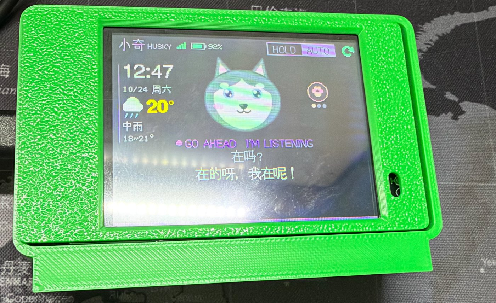
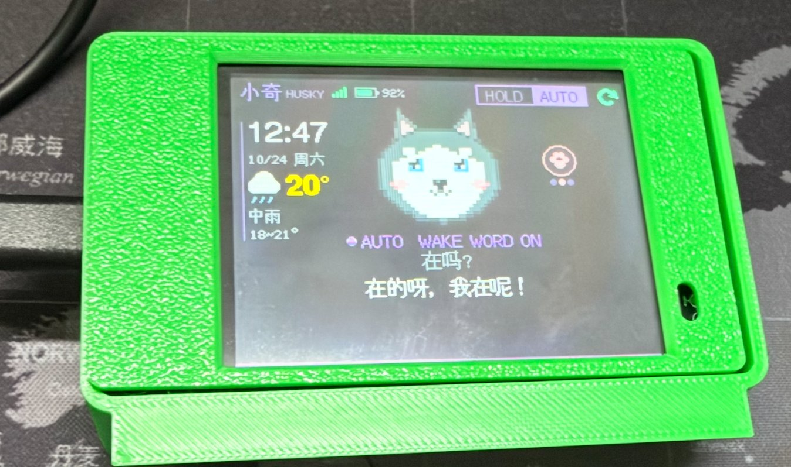
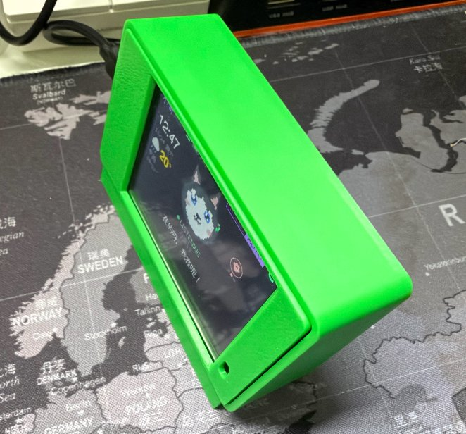
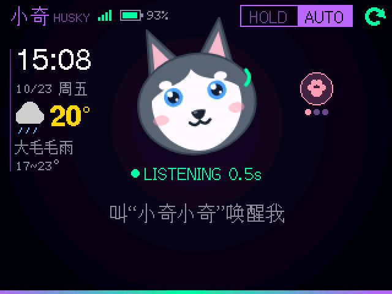
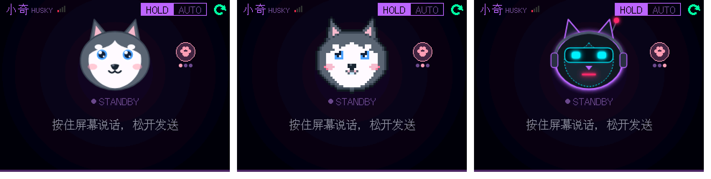
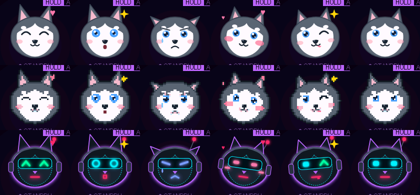
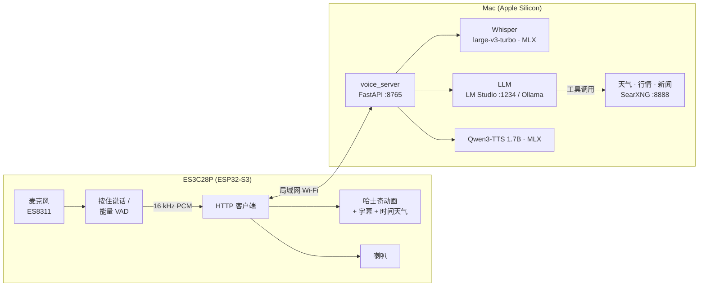
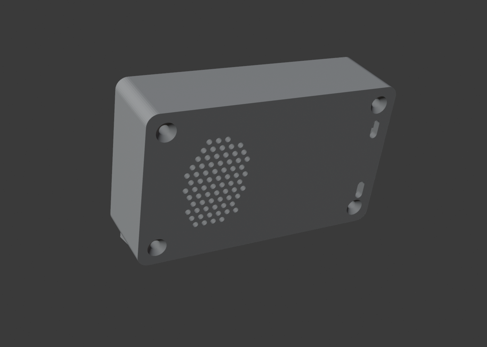
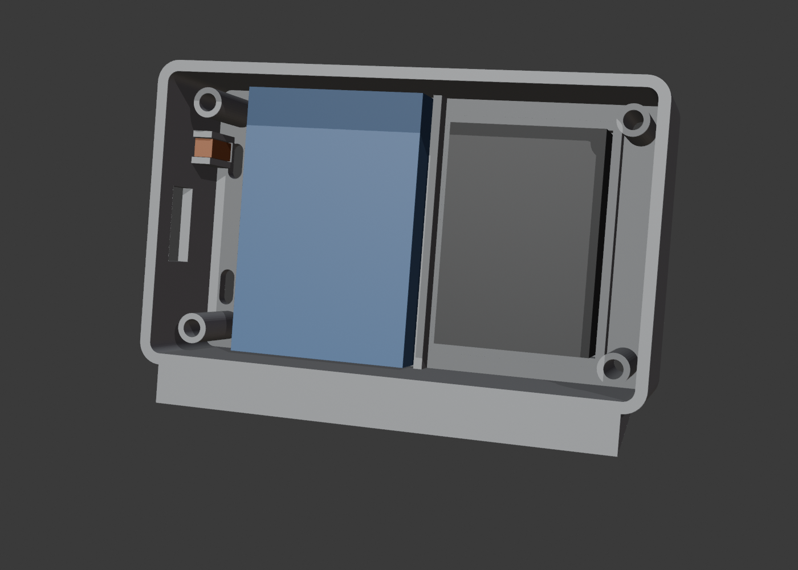

# 小奇 XiaoQi · 本地 AI 语音聊天机器人

[English](README.md) | **中文**

一只会随对话变表情的卡通哈士奇，住在一块 2.8 寸 ESP32-S3 触摸屏上。叫一声「小奇小奇」就能聊天、查天气、查股价、搜新闻。语音识别、大模型、语音合成和联网搜索**全部跑在你自己的 Mac 上**，不需要任何云端 AI 服务或 API Key。

<p align="center">
  
  <br>
  
  
</p>

## 特性

- **两种说话方式**：HOLD 按住屏幕说话；AUTO 免按键，喊「小奇小奇」唤醒（一口气说完问题也行），回答后 8 秒内可直接追问
- **会变表情的小奇**：三套造型（软萌 Q 版 / 像素风 / 赛博机械）× 19 帧；待机眨眼、犯困，听你说话时竖耳朵，思考时冒问号，说话时嘴巴随语音开合
- **情绪联动**：大模型给每句回答打情绪标签（开心 / 惊讶 / 难过 / 害羞 / 调皮 / 平静），表情和**语音语气**一起变
- **中英混合识别**：Whisper large-v3-turbo，约 0.2 秒一句
- **自然的中文语音**：Qwen3-TTS 1.7B，按情绪调整语气；可切回 Piper（更快）
- **联网查询**：天气（Open-Meteo）、股价 / 指数（腾讯行情）、科技新闻（RSS）走专用工具给出精确数据，其他实时问题走本地 SearXNG 搜索；全部免 API Key
- **时间与天气卡片**：待机时左侧显示时间、日期、所在城市的天气（NTP + Open-Meteo，15 分钟刷新）
- **多轮记忆**、Wi-Fi 信号与电池电量显示、可 3D 打印的桌面外壳（STL 和 Bambu 切片文件都在仓库里）

<p align="center">
  <br>
  
</p>

## 它是怎么工作的



一次对话：板子录音 → Mac 上 Whisper 转文字 →（AUTO 模式先判断是不是叫了「小奇」）→ 大模型回答（需要时调用天气 / 行情 / 新闻 / 搜索工具）并给出情绪 → Qwen3-TTS 按情绪合成语音 → 板子显示字幕、切换表情、播放。详见 [架构与数据流](docs/zh-CN/architecture.md)。

## 硬件

| 部件 | 说明 |
|---|---|
| **LCDWIKI ES3C28P** | ESP32-S3R8（8 MB PSRAM）+ 16 MB Flash，2.8" ILI9341V 320×240 IPS，FT6336G 电容触摸，ES8311 音频 + 板载 MEMS 麦克风 |
| 喇叭 | 8 Ω 1–2 W 小喇叭（接 SPEAKER 口），例如 40×28×10 mm 椭圆喇叭 |
| 锂电池（可选） | 3.7 V 单节 103450（34×50×10 mm），**1.25 mm 2P 插头**，接 BAT 口，USB-C 充电 |
| 拨动开关（可选） | SS12D00，串在电池正极线上 |
| 外壳（可选） | [enclosure/](enclosure/README.zh-CN.md)：两件式 PLA，约 77 分钟，4 颗 M3×25 沉头自攻螺丝 |

物料清单、接线图、引脚和已知坑见 [硬件](docs/zh-CN/hardware.md)。

## 快速开始

前提：Apple Silicon Mac（建议 32 GB 内存以上）、[Homebrew](https://brew.sh)、[LM Studio](https://lmstudio.ai)（或 Ollama）、USB-C 数据线连着板子。

1. **准备大模型**：在 LM Studio 里下载一个支持工具调用的聊天模型（推荐响应快的 MoE，例如 Qwen3-30B-A3B Instruct），加载后在 Developer 页点 Start Server（默认 `http://127.0.0.1:1234`）。
2. **一键安装**（依赖、模型、本地搜索、配置文件、编译并烧录固件）：

   ```bash
   git clone https://github.com/syu-lk4b/esp32-chatbot-local.git xiaoqi && cd xiaoqi
   ./install.sh            # 按提示填 Wi-Fi 名称/密码（仅 2.4 GHz）、选择模型、所在城市
   ```

   选项：`--no-flash`（只编译不烧录）、`--autostart`（登录时自动启动后台）、`--skip-models`。可重复运行，已有配置不会被覆盖。

3. **启动后台**：

   ```bash
   ./start.sh        # SearXNG + 语音服务；./start.sh stop 停止
   ```

4. **开聊**：右上角切到 **AUTO**，说「小奇小奇，明天会下雨吗？」；或在 **HOLD** 模式按住屏幕说话。

每一步的细节：[在 Mac 上启动后台服务](docs/zh-CN/mac-setup.md) · [刷机](docs/zh-CN/flashing.md)

> 建议在路由器里给 Mac 做 DHCP 地址保留：板子按安装时记录的 IP 找 Mac。

## 使用

| 操作 | 作用 |
|---|---|
| 右上角 **HOLD / AUTO** | 切换按住说话 / 唤醒词模式（断电保持） |
| 小奇右侧 🐾 | 切换造型（软萌 → 像素 → 赛博） |
| 右上角 ⟳ | 清空对话记忆 |
| 回答时点屏幕 | 打断 |
| AUTO 模式说话时点屏幕 | 立刻结束这句并发送 |

顶栏左侧是 Wi-Fi 信号和电池电量（插 USB 充电时显示闪电）。

## 3D 打印外壳

<p align="center">
  
  
  
</p>

| 文件 | 说明 |
|---|---|
| [`enclosure/stl/front_bezel.stl`](enclosure/stl/front_bezel.stl) | 前框，已摆好打印方向 |
| [`enclosure/stl/back_shell.stl`](enclosure/stl/back_shell.stl) | 后壳（含电池槽、喇叭槽、开关卡槽），已摆好打印方向 |
| [`enclosure/slice/*.3mf`](enclosure/slice) | Bambu P1S + PLA Basic 已切片，Bambu Studio 打开直接打印 |
| [`enclosure/gen_enclosure.py`](enclosure/gen_enclosure.py) | Blender 参数化脚本，改尺寸后重新生成 |

PLA 免支撑，约 77 分钟 / 34 g。装配步骤见 [外壳说明](enclosure/README.zh-CN.md)。

## 目录

```
install.sh / start.sh   一键安装 / 启动后台
server/                 语音服务（FastAPI）：ASR、LLM 工具循环、TTS、会话、测试
firmware/               ESP32-S3 固件（PlatformIO + LovyanGFX）
  tools/                造型绘制（skins.js）与素材生成（gen_skins.py）
searxng/                本地搜索引擎配置模板与启动脚本（源码由 install.sh 拉取）
enclosure/              Blender 参数化外壳、STL、Bambu 切片文件
tts-eval/               TTS 引擎对比试听工具
search-eval/            联网搜索方案评测（引擎与专用接口对比）
tools/                  串口日志 / 截屏脚本
docs/                   文档（zh-CN / en）与图片
```

## 文档

- [在 Mac 上启动后台服务](docs/zh-CN/mac-setup.md) — 需要哪些服务、端口、安装流程、启动 / 自启 / 防睡眠
- [刷机](docs/zh-CN/flashing.md) — PlatformIO 烧录、下载模式、串口日志与截屏
- [硬件](docs/zh-CN/hardware.md) — 物料清单、接线图、引脚表、供电与电池、已知坑
- [架构与数据流](docs/zh-CN/architecture.md) — 组件、时序图、HTTP API、延迟
- [配置](docs/zh-CN/configuration.md) — 环境变量、换模型 / 换语音、固件参数、串口调试命令
- [排错](docs/zh-CN/troubleshooting.md)

## 隐私与安全

- 语音、文字、对话记忆都只在你的局域网内处理；外发的只有天气 / 行情 / 新闻 / 搜索的查询词。
- 板子和服务之间用随机令牌（`VOICE_TOKEN`）校验。服务没有 TLS，**不要把 8765 端口暴露到公网**。
- 含 Wi-Fi 密码和令牌的 `server/.env`、`firmware/include/secrets.h` 由安装脚本在本地生成，已加入 `.gitignore`。

## 开发

```bash
cd server && make test                 # 单元 + 接口测试（mock，不加载模型）
cd firmware && pio run -t upload
python3 tools/snap.py shot.png "" --wait 8   # 截取板子屏幕
```

修改造型：编辑 `firmware/tools/skins.js` → `python3 firmware/tools/gen_skins.py`（需要 Google Chrome，用于渲染 SVG）→ 重新烧录。

## 许可与致谢

本项目代码、造型美术与外壳模型以 [MIT](LICENSE) 许可发布。运行时下载 / 使用的第三方组件遵循各自许可，安装脚本不会把它们打包进本仓库：

- [SearXNG](https://github.com/searxng/searxng)（AGPL-3.0，安装时克隆到 `searxng/src`）
- [OpenAI Whisper](https://github.com/openai/whisper) / [mlx-whisper](https://github.com/ml-explore/mlx-examples)、[mlx-audio](https://github.com/Blaizzy/mlx-audio)、[Qwen3-TTS](https://huggingface.co/mlx-community/Qwen3-TTS-12Hz-1.7B-CustomVoice-6bit)、[Piper](https://github.com/rhasspy/piper) —— 模型权重请以各自模型卡上的许可为准
- [LovyanGFX](https://github.com/lovyan03/LovyanGFX)、[ArduinoJson](https://github.com/bblanchon/ArduinoJson)
- 板子资料来自 [LCDWIKI](https://www.lcdwiki.com/2.8inch_ESP32-S3_Display)
