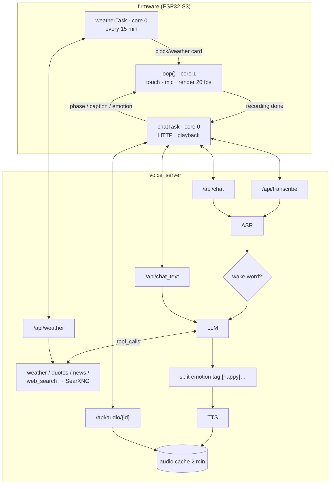
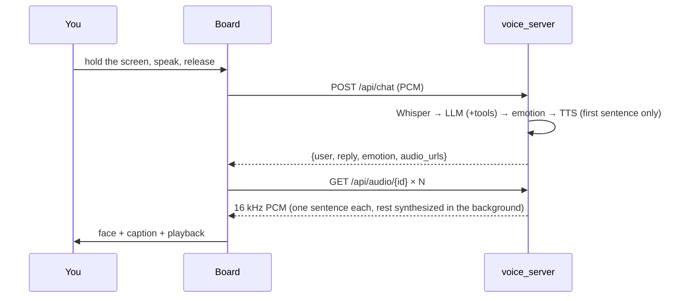
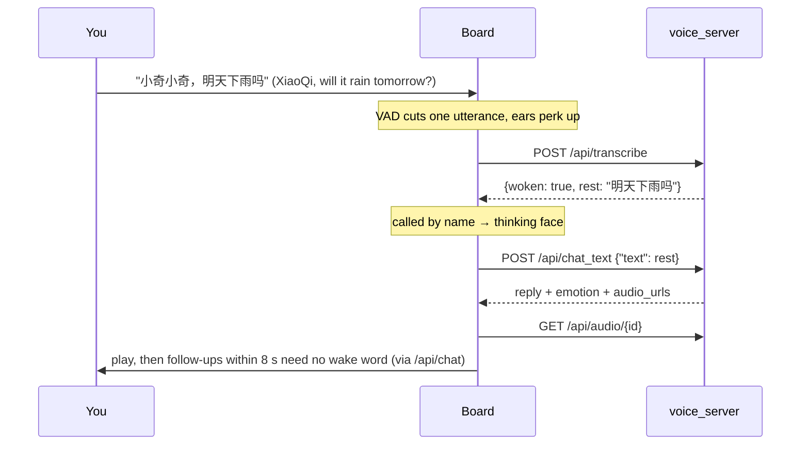

# Architecture and data flow

## Components

| Component | Location | Responsibility |
|---|---|---|
| Firmware | `firmware/` | touch / mic / display / speaker; HOLD recording or AUTO energy VAD; husky animation; HTTP client |
| Voice server | `server/voice_server/` | FastAPI; ASR → LLM (with tool loop) → TTS; conversation memory; token check |
| ASR | `engines.Asr` | `mlx-community/whisper-large-v3-turbo`, auto-detects Chinese/English; other detected languages are re-decoded as Chinese |
| LLM | `engines.Llm` | OpenAI-compatible API (LM Studio) or Ollama's native API, up to 2 tool rounds |
| Tools | `tools.py` | `get_weather` (Open-Meteo), `get_stock_quote` (Tencent quotes), `get_tech_news` (RSS, prefetched in the background), `web_search` (local SearXNG, results filtered and ranked by term overlap) |
| TTS | `engines.QwenTts` / `PiperTts` | Qwen3-TTS 1.7B (delivery set per emotion) or Piper (fast) |

Whisper and Qwen3-TTS both run on MLX and share one in-process lock (MLX can't be driven by several threads at once).

## Sequences

### HOLD: push-to-talk

### AUTO: wake word

If nobody said "小奇" (people talking, TV), only the cheap `/api/transcribe` call happens (~0.2 s); XiaoQi lowers its ears and stays idle without showing the thinking face.

## HTTP API

Every request carries `X-Token` (= `VOICE_TOKEN`) and `X-Device-Id` (the board sends its Wi-Fi MAC, used as the session key).

| Method | Path | Request | Response |
|---|---|---|---|
| POST | `/api/chat` | 16 kHz mono int16 LE PCM; optional `X-Hands-Free: 1` (returns an empty reply when nothing intelligible was heard, so the board stays quiet) | `{user, reply, emotion, audio_url, audio_bytes, audio_urls, audio_chars, tools, timing_ms}`; a leading wake word is stripped |
| POST | `/api/transcribe` | PCM | `{text, woken, rest, timing_ms}` |
| POST | `/api/chat_text` | `{"text": "..."}`; empty string = wake word only | same as `/api/chat`; empty text gets "我在呢，你说～" ("I'm here, go ahead") |
| GET | `/api/audio/{id}` | — | reply audio as PCM (valid for 2 min; waits for a sentence still being synthesized) |
| GET | `/api/weather` | — | `{city, temp, code, text, icon, min, max}` for the clock/weather card (shares the `get_weather` cache) |
| POST | `/api/reset` | — | clear this device's conversation memory |
| GET | `/health` | — | `{ok, llm}` |

## Design notes

- **Sentence-by-sentence speech**: the reply is split into chunks (`split_speech`; the first is kept short, cut at a comma if needed). The server synthesizes only the first before answering and the rest in the background, in order; `/api/audio/{id}` waits for a chunk that isn't ready yet. The board downloads chunk i+1 while chunk i plays, so time-to-first-sound depends on the first sentence, not the reply length.

- **Emotion tags**: the system prompt asks for a tag such as `[happy]` at the start of every reply; the server splits it into `emotion`. The board picks the face from it and TTS picks the delivery (`EMOTION_INSTRUCT`).
- **Wake word**: matched on Whisper's text, accepting common homophones (小琪 / 小齐 / 小七…). A single "小奇" must be followed by a pause, so words like "小奇怪" don't trigger it.
- **Tool routing**: keyword rules recognize weather / stock / news questions and add a hint naming the required tool. If the model answers without calling it, only says "let me check", or returns nothing, it gets one nudge. This keeps tool use reliable without a thinking mode (30/32 in tests, see `search-eval/RESULTS.md`).
- **Prompt caching**: the system prompt and tool list stay byte-identical; dynamic content such as the current time goes in the last message so LM Studio's prefix cache hits (~0.5 s on a hit vs ~2 s on a miss).
- **Search result filtering**: Bing often returns unrelated English pages for Chinese queries; `rank_results` drops results with low Chinese-bigram / English-word overlap.
- **Silence gate**: a clip counts as silence only if its overall RMS < 15. Normal speech averages ~70 including leading/trailing silence; the old gate of 60 dropped quiet speakers.
- **Wi-Fi**: on mesh networks the default fast scan joins the first AP it hears, which may be a distant one. The firmware scans all channels and sorts by signal, disables modem sleep (it slows uploads), and warms up the first connection with a short silent upload.

## Latency (measured on an M5 Max, for reference)

| Stage | Time |
|---|---|
| Speech recognition | 0.17–0.22 s |
| LLM (Qwen3-30B-A3B MoE) | 0.2–0.5 s |
| LLM (27B dense + thinking) | 1–4 s; 5–9 s with search |
| Qwen3-TTS 1.7B | 0.9–1.8 s (Piper ~0.05 s) |
| Board network round trip | 0.4–1 s (first request warmed up at boot) |
