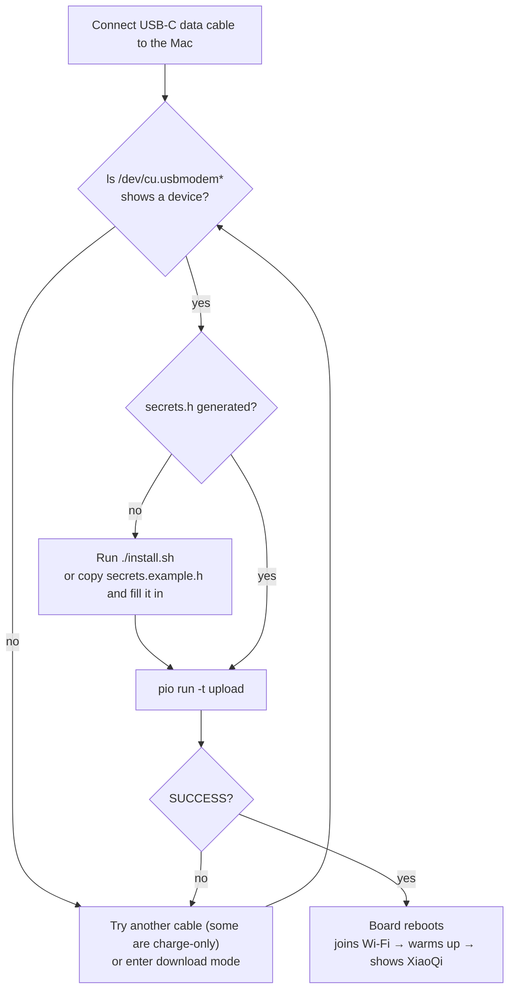

# Flashing the firmware

The ES3C28P's ESP32-S3 has native USB: **one USB-C data cable** flashes the firmware and carries the serial log. No external programmer or dock is needed.



## Option 1: install.sh (recommended)

The last step of `./install.sh` builds the firmware and flashes it if `/dev/cu.usbmodem*` is present. To flash again later:

```bash
cd firmware
../server/.venv/bin/pio run -t upload
```

## Option 2: PlatformIO by hand

1. Install PlatformIO (`install.sh` puts it in `server/.venv`; otherwise `pip install platformio` or the PlatformIO extension for VS Code).
2. Create `firmware/include/secrets.h` (gitignored, never committed):

   ```bash
   cp firmware/include/secrets.example.h firmware/include/secrets.h
   ```

   | Macro | Value |
   |---|---|
   | `WIFI_SSID` / `WIFI_PASS` | your 2.4 GHz Wi-Fi name and password |
   | `CHAT_SERVER` | `http://<Mac LAN IP>:8765`; find the IP with `ipconfig getifaddr en0` |
   | `CHAT_TOKEN` | same as `VOICE_TOKEN` in `server/.env` |

3. Build and flash:

   ```bash
   cd firmware
   pio run                       # build only; the first build downloads the ESP32 toolchain (~1 GB)
   pio run -t upload             # build + flash; with several boards add --upload-port /dev/cu.usbmodemXXXX
   ```

   Success ends with `[SUCCESS]`. The image is about 3 MB (including the three skins), roughly half of the 16 MB flash.

Key build settings (`firmware/platformio.ini`): `espressif32@6.8.1` (Arduino core 2.0.17), `board_build.arduino.memory_type = qio_opi` (8 MB octal PSRAM, required), a 16 MB partition table, and `ARDUINO_USB_CDC_ON_BOOT=1` (serial over USB).

## Download mode

Normally nothing is needed: PlatformIO puts the chip into download mode over USB. If the upload fails with `Failed to connect` / `No serial data received`, or a previous firmware broke USB:

1. Hold **BOOT**
2. Press and release **RESET**
3. Release **BOOT**
4. Run `pio run -t upload` again, then press RESET once to start the new firmware

Inside the enclosure, BOOT and RESET sit behind the two slots on the back; use a paper clip.

## Serial log and screenshots

```bash
pip install pyserial pillow                     # deps of the tools/ scripts (server/.venv usually has pyserial)
python3 tools/mon.py 30                         # 30 s of log
python3 tools/mon.py 30 --reset                 # reset first to see the whole boot
python3 tools/snap.py shot.png "" --wait 10     # capture the screen as PNG
pio device monitor                              # or PlatformIO's monitor (115200)
```

With several USB serial devices, set `ESP_PORT=/dev/cu.usbmodemXXXX`. Note: **opening the port resets the board**; wait 8–10 s for boot before sending commands.

Useful boot log lines:

```
[wifi] connected ... bssid=… rssi=-52     ← signal strength; below -75 gets sluggish
[warmup] upload ok                        ← the connection to the Mac is warmed up
```

Single-character serial commands (`t` test tone, `m` mode, `k` skin, `v` levels, `b` battery, `c` screenshot): see [Configuration](configuration.md#serial-commands).

## Regenerating skins after editing them

```bash
python3 firmware/tools/gen_skins.py      # needs Google Chrome (headless SVG rendering)
cd firmware && pio run -t upload
```

## Erase / restore

```bash
cd firmware
pio run -t erase                         # full erase (HOLD/AUTO, skin and other NVS settings are lost)
pio run -t upload
```

The board ships with LCDWIKI's demo firmware; the bin files and flash tool in the download package on the [LCDWIKI product page](https://www.lcdwiki.com/2.8inch_ESP32-S3_Display) restore it.
