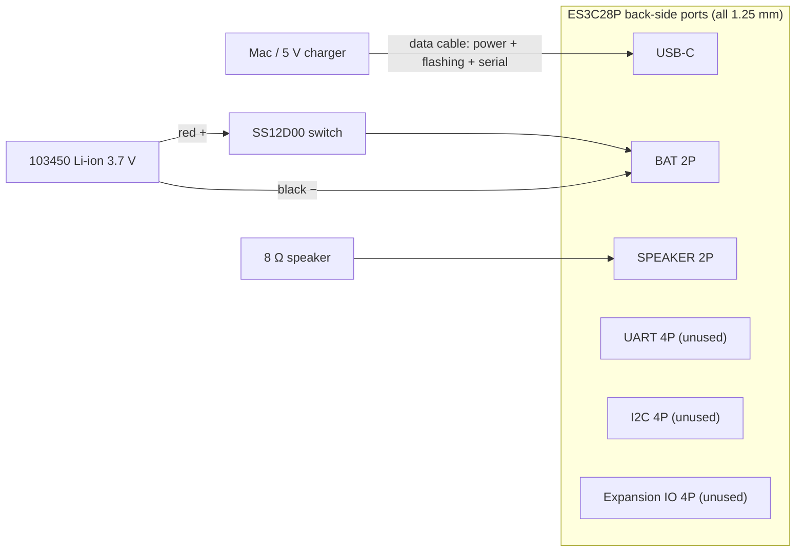

# Hardware

## Bill of materials

| Part | Required | Notes |
|---|---|---|
| **LCDWIKI ES3C28P** 2.8" ESP32-S3 touch display module | ✅ | the touch version (ES3N28P has no touch, so HOLD and on-screen buttons won't work) |
| Small speaker, 8 Ω 1–2 W, 1.25 mm 2-pin plug | ✅ | the enclosure fits a 40 × 28 × 10 mm oval speaker |
| USB-C **data** cable | ✅ | power + flashing; a charge-only cable won't show up as a device |
| 3.7 V single-cell Li-ion 103450 (34 × 50 × 10 mm), 1.25 mm 2-pin plug, with protection board | optional | cordless use; ~8 h on 2000 mAh |
| SS12D00 mini slide switch | optional | power switch in series with the battery's positive lead |
| 3D-printed enclosure + 4 × M3×25 countersunk self-tapping screws | optional | see [Enclosure](../../enclosure/README.md) |

Microphone, audio codec, amplifier and Li-ion charger are all on the board; no extra modules are needed.

## Wiring

- Only **USB-C, BAT and SPEAKER** are used. The UART / I2C / expansion-IO 4-pin sockets are for other peripherals; the 4-pin-to-Dupont cable in the box is for those and isn't needed here.
- **Check the battery plug's polarity** before plugging it in: 1.25 mm plugs are not wired consistently across vendors, and reversing them can kill the board.
- The board needs **2.4 GHz** Wi-Fi on the same LAN as the Mac.

Flashing and serial: see [Flashing](flashing.md).

## Main board: LCDWIKI ES3C28P

Official documents (specification, user manual, schematic, Arduino demo notes) are on the [LCDWIKI product page](https://www.lcdwiki.com/2.8inch_ESP32-S3_Display). The outline drawing is on page 13 of the [specification](https://www.lcdwiki.com/res/ES3C28P/ES3C28P_ES2N28P_Specification_V1.0.pdf).

| Item | Spec |
|---|---|
| SoC | ESP32-S3R8 (QFN56), 240 MHz dual-core, 8 MB embedded **octal (OPI)** PSRAM |
| Flash | 16 MB QSPI |
| USB | native USB-Serial/JTAG (`/dev/cu.usbmodem*`); flashing and serial both over USB-C |
| Display | ILI9341V, 240×320, SPI, IPS (needs `invert = true`) |
| Touch | FT6336G capacitive, I2C address 0x38 |
| Audio | ES8311 codec (I2C 0x18) + on-board MEMS mic + FM8002E amplifier (external speaker) |
| Other | MicroSD (SDIO 4-bit), WS2812 RGB LED, TP4054 Li-ion charger (~290 mA), BOOT / RESET buttons |
| Size | PCB 86 × 50 mm, 10.6 mm total thickness; 4 × Ø3.2 mounting holes, 78 × 42 mm pitch |

## Pinout

| Function | GPIO |
|---|---|
| LCD MOSI / MISO / SCLK / CS / DC | 11 / 13 / 12 / 10 / 46 |
| LCD backlight (active high, PWM-able) | 45 |
| LCD RST | tied to chip reset |
| I2C SDA / SCL (shared by touch + ES8311) | 16 / 15 |
| Touch INT / RST | 17 / 18 |
| I2S MCLK / BCLK / LRCK | 4 / 5 / 7 |
| **I2S speaker data (ESP32 → ES8311 DSDIN)** | **8** |
| **I2S mic data (ES8311 ASDOUT → ESP32)** | **6** |
| Amplifier enable (active low) | 1 |
| SD CLK / CMD / D0–D3 | 38 / 40 / 39 / 41 / 48 / 47 |
| RGB LED (WS2812) | 42 |
| BOOT button | 0 |
| Battery voltage ADC (200k/200k divider, reading × 2) | 9 |
| Expansion IO | 2, 3, 14, 21 |

On-board sockets (all 1.25 mm pitch): **BAT** 2P (Li-ion), **SPEAKER** 2P, **UART** 4P (carries 5 V; never plug the battery in here), I2C 4P, expansion IO 4P.

## Power and battery

- **USB-C 5 V** powers the board, charges the battery, and is used for flashing / serial. With USB plugged in the board runs from USB and the battery charges separately.
- **BAT** takes a **3.7 V single-cell Li-ion/LiPo only** (4.2 V full). **Never connect 5 V or AA/alkaline cells**: BAT goes straight to the Li-ion charger IC.
- Recommended: **103450, 2000 mAh** (34 × 50 × 10 mm, fits the enclosure's battery bay), with a protection board and a **1.25 mm 2-pin plug**. Check polarity first (the silkscreen "+" is on the right pin).
- Rough budget: ~200 mA average (Wi-Fi always on + backlight), so ~8 h on 2000 mAh; a full charge takes 7–8 h.
- The board has no power switch; put an SS12D00 slide switch in the battery's positive lead (the enclosure has a slot for it). With the switch off, USB powers the board but doesn't charge the battery.
- Battery gauge limitation: on USB with no battery attached, the charger holds BAT at ~4.13 V and the icon shows ~93%.

## Speaker

An 8 Ω 1–2 W speaker on the SPEAKER port. The enclosure is designed around a 40 × 28 × 10 mm oval speaker that fires through the back grille.

## Enclosure

See [enclosure/README.md](../../enclosure/README.md): two parts (front bezel + back shell), PLA without supports, ~77 min on a Bambu P1S; 4 × **M3×25 countersunk self-tapping screws** (length verified: the tip stops 1 mm short of the bezel face). The back shell holds the battery, speaker and switch, with a USB-C opening on the left and pin holes for RESET / BOOT on the back.

## Gotchas

- **I2S data direction**: the widely shared community BSP has GPIO6 / 8 swapped. Follow the official GPIO table: ESP32 output `I2S_DO` = IO8, input `I2S_DI` = IO6. The schematic's net names are from the codec's side, so they look reversed.
- **ES8311 shares I2C with touch**: LovyanGFX already owns I2C port 0; write ES8311 registers with `lgfx::i2c::writeRegister8` instead of grabbing the bus with `Wire`.
- **Touch orientation**: the FT6336 is rotated 180° relative to the panel; set `offset_rotation = 2` in LovyanGFX.
- **PSRAM is octal**: PlatformIO needs `board_build.arduino.memory_type = qio_opi`.
- **Serial log**: in USB-CDC mode `log_e` goes to UART0 and is invisible; use `Serial.printf`. Opening the serial port resets the chip.
- **Wi-Fi**: 2.4 GHz only. On mesh networks, scan all channels and pick the AP by signal strength; disable modem sleep for fast uploads.
