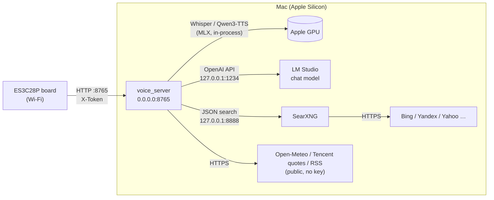
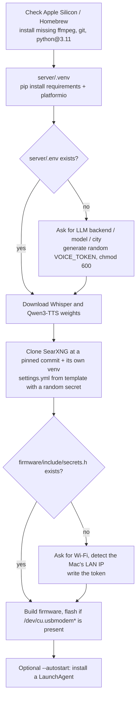
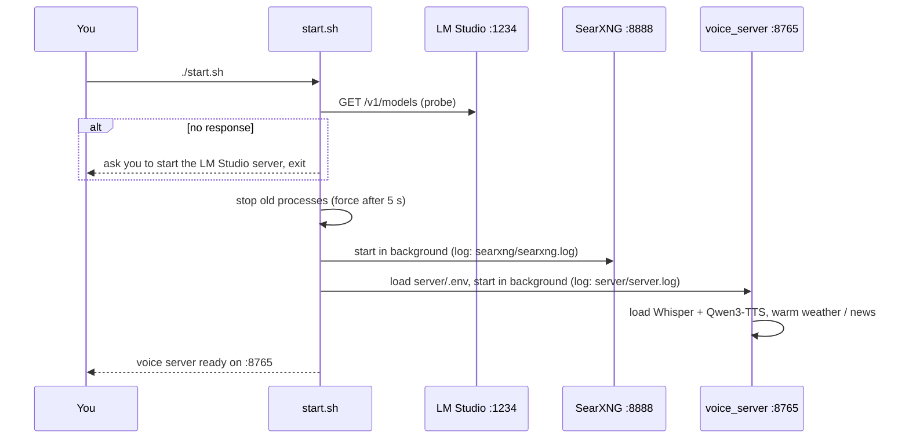

# Running the services on a Mac

XiaoQi's "brain" lives on the Mac; the board only records, displays and plays audio. Three services run on the Mac:

| Service | Port | Role | Started by |
|---|---|---|---|
| **LM Studio** (or Ollama) | `127.0.0.1:1234` (Ollama `11434`) | LLM inference (OpenAI-compatible API with tool calling) | you, or its own start-at-login setting |
| **SearXNG** | `127.0.0.1:8888` | local metasearch engine behind the `web_search` tool | `./start.sh` |
| **voice_server** | `0.0.0.0:8765` | FastAPI: speech recognition → LLM → speech synthesis; the board talks to it | `./start.sh` |



Only voice_server listens on the LAN; LM Studio and SearXNG stay on localhost.

## Requirements

- An Apple Silicon Mac (M1 or later). Whisper and Qwen3-TTS run on the GPU through MLX; Intel Macs are not supported.
- macOS 14 or later and [Homebrew](https://brew.sh).
- Memory: the speech models (Whisper + Qwen3-TTS) take about 4 GB, plus the chat model, e.g. ~17 GB for Qwen3-30B-A3B at 4-bit. **32 GB or more** is comfortable; on 16 GB use a smaller chat model (e.g. Qwen3-8B) or `TTS_ENGINE=piper`.
- Disk: from a few GB to 20+ GB of model weights, depending on the chat model.
- The Mac and the board on the **same LAN**; the board only supports **2.4 GHz** Wi-Fi.

## Step 1: the LLM (LM Studio)

1. Install [LM Studio](https://lmstudio.ai) and download a chat model **with tool-calling support** from Discover. A fast MoE model such as `Qwen3-30B-A3B-Instruct-2507` is recommended.
2. Load the model, open the **Developer** tab and click **Start Server** (default `http://127.0.0.1:1234`).
3. Check it:

   ```bash
   curl -s http://127.0.0.1:1234/v1/models | python3 -m json.tool
   ```

   The `id` you see is the `LLM_MODEL` value used later.

For a thinking/reasoning model, set `LLM_REASONING_EFFORT=none` in `server/.env`; replies get 2–3× faster.

<details>
<summary>Using Ollama instead</summary>

```bash
brew install ollama && ollama serve &
ollama pull qwen3:30b-a3b-instruct-2507-q4_K_M
```

In `server/.env` set `LLM_BACKEND=ollama`, `LLM_URL=http://127.0.0.1:11434`, `LLM_MODEL=qwen3:30b-a3b-instruct-2507-q4_K_M`.
</details>

## Step 2: one-command install

```bash
git clone https://github.com/syu-lk4b/esp32-chatbot-local.git xiaoqi
cd xiaoqi
./install.sh
```

The script runs these steps in order. It is safe to re-run and never overwrites existing config:



| Option | Effect |
|---|---|
| `--no-flash` | build without flashing (e.g. before the board arrives) |
| `--skip-models` | skip pre-downloading speech models (they download on first server start) |
| `--autostart` | run `start.sh` at login |
| `NONINTERACTIVE=1 WIFI_SSID=… WIFI_PASS=… ./install.sh` | unattended install with defaults for everything else |

Both generated private files are gitignored: `server/.env` (server config and token) and `firmware/include/secrets.h` (Wi-Fi and token).

## Step 3: start the services

```bash
./start.sh          # starts SearXNG + voice_server, returns once ready
./start.sh stop     # stops both
```



Check that everything is up:

```bash
curl -s http://127.0.0.1:8765/health          # {"ok":true,"llm":"openai:<model>"}
curl -s "http://127.0.0.1:8888/search?q=test&format=json" | head -c 200
tail -f server/server.log                     # transcripts, tool calls and per-stage timings
```

On first start macOS may ask whether python may accept incoming network connections: choose **Allow**, or the board can't connect.

### Starting manually, without start.sh

```bash
(cd searxng && ./run.sh)                                              # terminal 1
cd server && set -a && . ./.env && set +a && .venv/bin/python -m voice_server   # terminal 2
```

`server/Makefile` also has `make dev` (run the server in the foreground) and `make test`.

## Keeping it always on

The board looks for the Mac at the IP recorded during install, so:

1. **Pin the Mac's IP**: add a DHCP reservation in your router. If the IP changes, update `CHAT_SERVER` in `firmware/include/secrets.h` and reflash.
2. **Start at login**: `./install.sh --autostart` installs a LaunchAgent (`~/Library/LaunchAgents/com.xiaoqi.voicechat.plist`); in LM Studio enable starting the server at login.
3. **No sleep**: System Settings → Battery / Energy → prevent automatic sleeping on power adapter, or `sudo pmset -c sleep 0`. For a temporary keep-awake, `caffeinate -s`.

Removing the autostart:

```bash
launchctl unload ~/Library/LaunchAgents/com.xiaoqi.voicechat.plist
rm ~/Library/LaunchAgents/com.xiaoqi.voicechat.plist
```

## Logs and data

| Location | Contents |
|---|---|
| `server/server.log` | server log, including transcripts and replies (personal data; gitignored) |
| `searxng/searxng.log` | search service log |
| `server/debug_clips/` | recordings that transcribed to nothing, for debugging; set `DEBUG_CLIPS_DIR=` to disable |

Conversation memory lives only in the voice_server process (last 8 turns per device, cleared after 10 idle minutes). It is never written to disk and is gone on restart; ⟳ on the screen clears it too.
