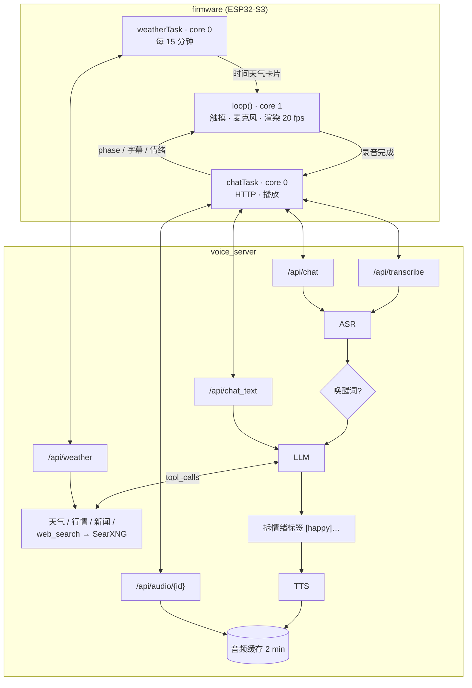
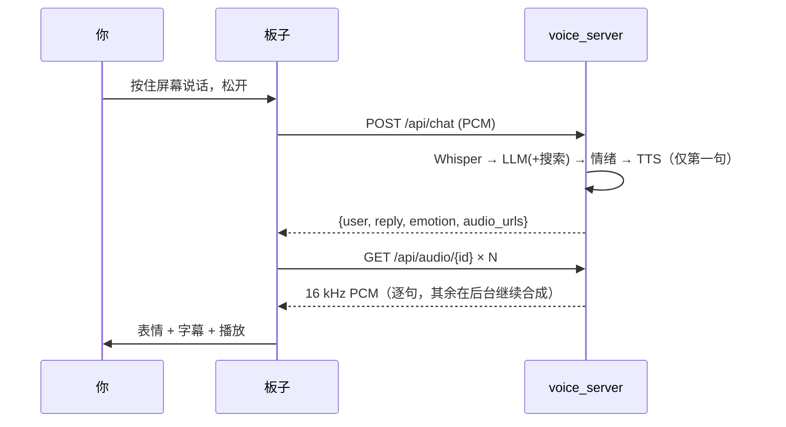
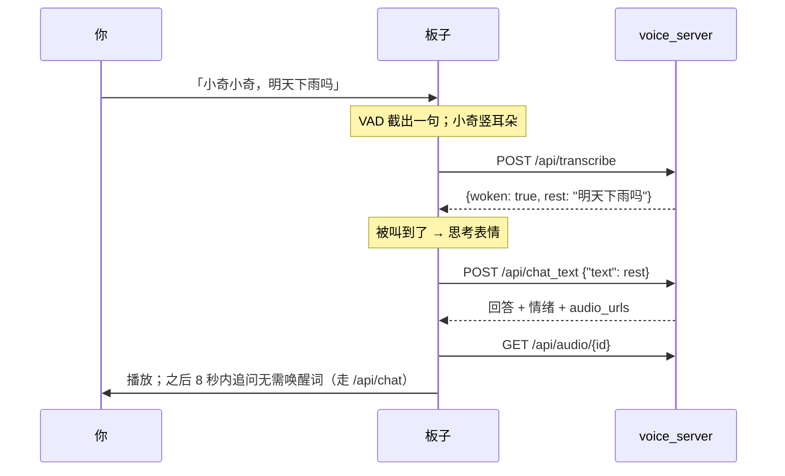

# 架构与数据流

## 组件

| 组件 | 位置 | 职责 |
|---|---|---|
| 固件 | `firmware/` | 触摸 / 麦克风 / 屏幕 / 喇叭；HOLD 录音或 AUTO 能量 VAD；哈士奇动画；HTTP 客户端 |
| 语音服务 | `server/voice_server/` | FastAPI；ASR → LLM（带工具循环）→ TTS；会话记忆；令牌校验 |
| ASR | `engines.Asr` | `mlx-community/whisper-large-v3-turbo`，自动识别中/英文，其他语种结果按中文重解 |
| LLM | `engines.Llm` | OpenAI 兼容接口（LM Studio）或 Ollama 原生接口，最多 2 轮工具调用 |
| 工具 | `tools.py` | `get_weather`（Open-Meteo）、`get_stock_quote`（腾讯行情）、`get_tech_news`（RSS，后台预取）、`web_search`（本地 SearXNG，结果按词重叠度过滤排序） |
| TTS | `engines.QwenTts` / `PiperTts` | Qwen3-TTS 1.7B（按情绪设定语气）或 Piper（快） |

Whisper 与 Qwen3-TTS 都跑在 MLX 上，共用一把进程内锁（MLX 不能被多个线程同时驱动）。

## 时序

### HOLD：按住说话

### AUTO：唤醒词

没叫「小奇」的话（旁人聊天、电视），只走一次很便宜的 `/api/transcribe`（约 0.2 s），小奇放下耳朵继续待机，不会露出思考表情。

## HTTP API

所有请求带 `X-Token`（= `VOICE_TOKEN`）和 `X-Device-Id`（板子发 Wi-Fi MAC，用作会话 key）。

| 方法 | 路径 | 请求 | 响应 |
|---|---|---|---|
| POST | `/api/chat` | 16 kHz mono int16 LE PCM；可选 `X-Hands-Free: 1`（没听清时返回空回复，保持安静） | `{user, reply, emotion, audio_url, audio_bytes, audio_urls, audio_chars, tools, timing_ms}`；开头的唤醒词会先剥掉 |
| POST | `/api/transcribe` | PCM | `{text, woken, rest, timing_ms}` |
| POST | `/api/chat_text` | `{"text": "..."}`；空字符串 = 只喊了唤醒词 | 同 `/api/chat`；空文本回「我在呢，你说～」 |
| GET | `/api/audio/{id}` | — | 回复语音 PCM（2 分钟内有效；还没合成好的句子会等它合成完） |
| GET | `/api/weather` | — | `{city, temp, code, text, icon, min, max}`，供板子的时间天气卡片使用（与 `get_weather` 共用缓存） |
| POST | `/api/reset` | — | 清空该设备的对话记忆 |
| GET | `/health` | — | `{ok, llm}` |

## 关键设计

- **逐句语音**：回复按句切块（`split_speech`，第一块尽量短，必要时在逗号处切开），服务端只合成第一块就返回，其余块在后台按顺序合成；`/api/audio/{id}` 遇到还没合成好的块会等待。板子播放第 i 块时由预取任务下载第 i+1 块，所以开口延迟只取决于第一句，和回复长短无关。

- **情绪标签**：系统提示词要求回答以 `[happy]` 等标签开头；服务端拆出 `emotion` 字段，板子据此选表情，TTS 据此选语气（`EMOTION_INSTRUCT`）。
- **唤醒词识别**：在 Whisper 文本上做，接受常见同音写法（小琪 / 小齐 / 小七…）；只叫一遍「小奇」时后面必须停顿，避免「小奇怪」误触发。
- **工具路由**：关键词识别天气 / 股价 / 新闻类问题，在问题前提示必须调用哪个工具；模型没调工具就作答、只说「我查一下」或给出空回答时会被追加一次催促。这样不开思考模式也能稳定用对工具（实测 30/32，见 `search-eval/RESULTS.md`）。
- **提示缓存**：系统提示词与工具列表保持逐字不变，时间等动态内容放在最后一条消息，让 LM Studio 的前缀缓存命中（命中约 0.5 s，失效约 2 s）。
- **搜索结果过滤**：Bing 常给中文查询返回无关英文页，`rank_results` 用中文二元词 + 英文词的重叠度丢弃低相关结果。
- **静音门槛**：整段 RMS < 15 才视为静音。正常说话整段平均约 70（含前后静音），旧门槛 60 会误丢小声说话。
- **Wi-Fi**：Mesh 环境下默认快速扫描会连上第一个听到的远端 AP，固件改为全信道扫描 + 按信号排序；关闭 modem sleep 以免上传变慢；连上后先上传一段静音预热首个连接。

## 延迟（M5 Max 实测，仅供参考）

| 环节 | 耗时 |
|---|---|
| 语音识别 | 0.17–0.22 s |
| LLM（Qwen3-30B-A3B MoE） | 0.2–0.5 s |
| LLM（27B 稠密 + 思考） | 1–4 s；带搜索 5–9 s |
| Qwen3-TTS 1.7B | 0.9–1.8 s（Piper 约 0.05 s） |
| 板子网络往返 | 0.4–1 s（开机首次请求已预热） |
