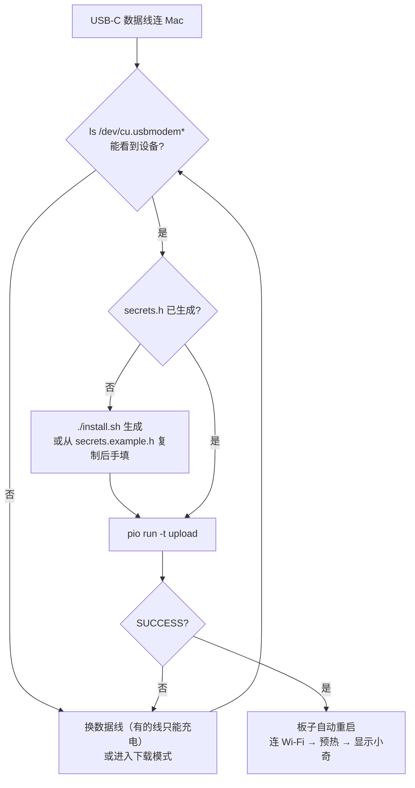

# 刷机（烧录固件）

ES3C28P 的 ESP32-S3 带原生 USB，**一根 USB-C 数据线**就能刷机、看串口日志，不需要额外的下载器或底座。



## 方式一：install.sh（推荐）

`./install.sh` 最后一步会编译固件，检测到 `/dev/cu.usbmodem*` 就直接烧录。只想重新烧一次：

```bash
cd firmware
../server/.venv/bin/pio run -t upload
```

## 方式二：手动用 PlatformIO

1. 安装 PlatformIO（`install.sh` 已装进 `server/.venv`；单独装用 `pip install platformio` 或 VS Code 的 PlatformIO 插件）。
2. 生成 `firmware/include/secrets.h`（已 gitignore，不会被提交）：

   ```bash
   cp firmware/include/secrets.example.h firmware/include/secrets.h
   ```

   | 宏 | 填什么 |
   |---|---|
   | `WIFI_SSID` / `WIFI_PASS` | 2.4 GHz Wi-Fi 名称和密码 |
   | `CHAT_SERVER` | `http://<Mac 的局域网 IP>:8765`，IP 用 `ipconfig getifaddr en0` 查 |
   | `CHAT_TOKEN` | 和 `server/.env` 的 `VOICE_TOKEN` 一致 |

3. 编译并烧录：

   ```bash
   cd firmware
   pio run                       # 只编译；首次会下载 ESP32 工具链（约 1 GB）
   pio run -t upload             # 编译 + 烧录；多块板子时加 --upload-port /dev/cu.usbmodemXXXX
   ```

   成功时输出 `[SUCCESS]`，固件约 3 MB（含三套造型素材），占 16 MB Flash 的一半左右。

构建配置（`firmware/platformio.ini`）的要点：`espressif32@6.8.1`（Arduino core 2.0.17）、`board_build.arduino.memory_type = qio_opi`（8 MB OPI PSRAM，必须）、16 MB 分区表、`ARDUINO_USB_CDC_ON_BOOT=1`（串口走 USB）。

## 下载模式

正常情况下不需要手动操作：PlatformIO 会通过 USB 自动让芯片进入下载模式。如果烧录报 `Failed to connect` / `No serial data received`，或者之前的固件把 USB 搞挂了：

1. 按住 **BOOT** 键
2. 按一下 **RESET** 键再松开
3. 松开 **BOOT** 键
4. 重新 `pio run -t upload`，完成后按一次 RESET 运行新固件

装进外壳后，BOOT / RESET 在背面两个长孔里，用回形针按。

## 看串口日志、截屏

```bash
pip install pyserial pillow                     # tools/ 脚本的依赖（server/.venv 里一般已有 pyserial）
python3 tools/mon.py 30                         # 看 30 秒日志
python3 tools/mon.py 30 --reset                 # 先复位再看，能看到完整启动过程
python3 tools/snap.py shot.png "" --wait 10     # 截取屏幕画面为 PNG
pio device monitor                              # 或者用 PlatformIO 自带监视器（115200）
```

有多个 USB 串口设备时，用 `ESP_PORT=/dev/cu.usbmodemXXXX` 指定。注意：**打开串口会让板子复位**，发命令前等 8–10 秒启动完成。

启动日志里值得看的几行：

```
[wifi] connected ... bssid=… rssi=-52     ← 信号强度，低于 -75 容易卡
[warmup] upload ok                        ← 已预热和 Mac 的连接
```

串口单字符调试命令（`t` 测试音、`m` 切模式、`k` 切造型、`v` 音量、`b` 电池、`c` 截屏）见 [配置](configuration.md#串口调试命令)。

## 修改造型后重新生成素材

```bash
python3 firmware/tools/gen_skins.py      # 需要 Google Chrome（无头模式渲染 SVG）
cd firmware && pio run -t upload
```

## 恢复 / 擦除

```bash
cd firmware
pio run -t erase                         # 整片擦除（保存在 NVS 里的 HOLD/AUTO、造型等设置会清掉）
pio run -t upload
```

板子出厂自带的是 LCDWIKI 演示固件，可以从 [LCDWIKI 产品页](https://www.lcdwiki.com/2.8inch_ESP32-S3_Display) 下载资料包里的 bin 和烧录工具恢复。
