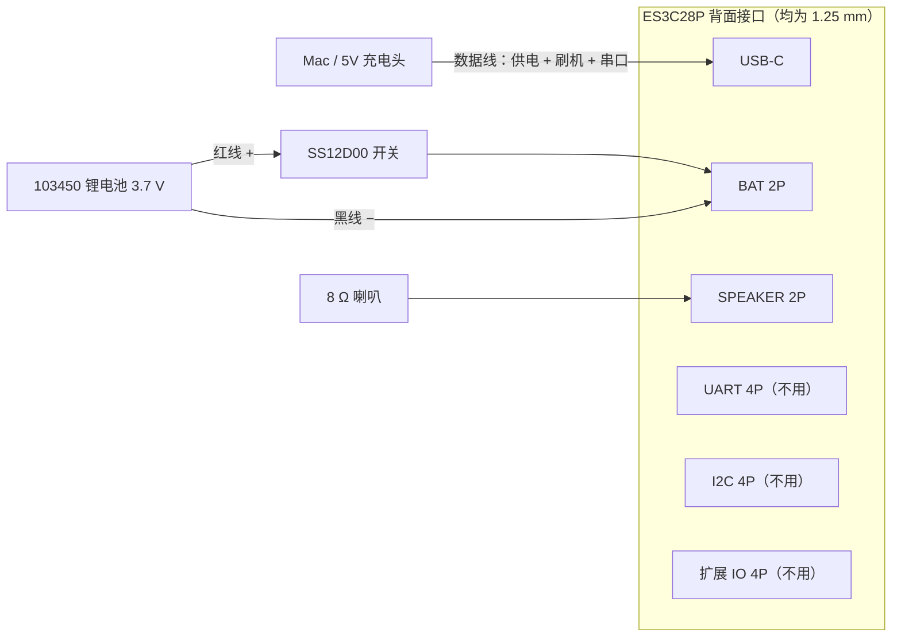

# 硬件

## 物料清单

| 部件 | 必需 | 说明 |
|---|---|---|
| **LCDWIKI ES3C28P** 2.8" ESP32-S3 触摸屏模块 | ✅ | 带触摸的型号（ES3N28P 是无触摸版，不能用 HOLD 和按钮） |
| 小喇叭 8 Ω 1–2 W，1.25 mm 2P 插头 | ✅ | 外壳按 40 × 28 × 10 mm 椭圆喇叭设计 |
| USB-C **数据线** | ✅ | 供电 + 刷机；只能充电的线认不到设备 |
| 3.7 V 单节锂电池 103450（34 × 50 × 10 mm），1.25 mm 2P 插头，带保护板 | 可选 | 无线使用；2000 mAh 约 8 小时 |
| SS12D00 小拨动开关 | 可选 | 串在电池正极线上当电源开关 |
| 3D 打印外壳 + 4 颗 M3×25 沉头自攻螺丝 | 可选 | 见 [外壳](../../enclosure/README.zh-CN.md) |

麦克风、音频 codec、功放、锂电充电都在板上，不需要额外模块。

## 接线

- 只用到 **USB-C、BAT、SPEAKER** 三个口。UART / I2C / 扩展 IO 三个 4P 座是给其他外设预留的，盒子里附带的 4P 转杜邦线就是接它们用的，本项目不需要。
- 电池插头**先核对正负极**再插：不同厂家的 1.25 mm 插头线序不统一，插反可能烧板。
- 板子要求 **2.4 GHz** Wi-Fi，并且和 Mac 在同一局域网。

刷机和串口见 [刷机](flashing.md)。

## 主板：LCDWIKI ES3C28P

官方资料（规格书、用户手册、原理图、Arduino 示例说明）在 [LCDWIKI 产品页](https://www.lcdwiki.com/2.8inch_ESP32-S3_Display)。外形尺寸图在 [规格书](https://www.lcdwiki.com/res/ES3C28P/ES3C28P_ES2N28P_Specification_V1.0.pdf) 第 13 页。

| 项 | 规格 |
|---|---|
| SoC | ESP32-S3R8（QFN56），240 MHz 双核，8 MB 内置 **OPI** PSRAM |
| Flash | 16 MB QSPI |
| USB | 原生 USB-Serial/JTAG（`/dev/cu.usbmodem*`），刷机和串口都走 USB-C |
| 屏幕 | ILI9341V，240×320，SPI，IPS（需要 `invert = true`） |
| 触摸 | FT6336G 电容触摸，I2C 地址 0x38 |
| 音频 | ES8311 codec（I2C 0x18）+ 板载 MEMS 麦克风 + FM8002E 功放（外接喇叭） |
| 其他 | MicroSD（SDIO 4-bit）、WS2812 RGB、TP4054 锂电充电（约 290 mA）、BOOT / RESET 键 |
| 尺寸 | PCB 86 × 50 mm，总厚 10.6 mm；安装孔 Ø3.2 × 4，孔距 78 × 42 mm |

## 引脚

| 功能 | GPIO |
|---|---|
| LCD MOSI / MISO / SCLK / CS / DC | 11 / 13 / 12 / 10 / 46 |
| LCD 背光（高电平亮，可 PWM） | 45 |
| LCD RST | 跟随芯片复位 |
| I2C SDA / SCL（触摸 + ES8311 共用） | 16 / 15 |
| 触摸 INT / RST | 17 / 18 |
| I2S MCLK / BCLK / LRCK | 4 / 5 / 7 |
| **I2S 喇叭数据（ESP32 → ES8311 DSDIN）** | **8** |
| **I2S 麦克风数据（ES8311 ASDOUT → ESP32）** | **6** |
| 功放使能（低电平有效） | 1 |
| SD CLK / CMD / D0–D3 | 38 / 40 / 39 / 41 / 48 / 47 |
| RGB LED（WS2812） | 42 |
| BOOT 键 | 0 |
| 电池电压 ADC（200k/200k 分压，读数 × 2） | 9 |
| 扩展 IO | 2, 3, 14, 21 |

板载接口（都是 1.25 mm 间距）：**BAT** 2P（锂电池）、**SPEAKER** 2P、**UART** 4P（含 5V，别把电池插错到这里）、I2C 4P、扩展 IO 4P。

## 供电与电池

- **USB-C 5V**：给板子供电，同时给电池充电，也用于刷机 / 串口。插着 USB 时板子自动切到 USB 供电，电池单独充电。
- **BAT**：只接 **3.7 V 单节锂电池**（满电 4.2 V）。**不要接 5V 或干电池**，BAT 后面直接是锂电池充电芯片。
- 推荐 **103450 2000 mAh**（34 × 50 × 10 mm，正好放进外壳电池槽），带保护板、**1.25 mm 2P 插头**，插前核对正负极（板上丝印「+」在右侧针脚）。
- 估算功耗：平均约 200 mA（Wi-Fi 常连 + 背光），2000 mAh 约 8 小时；充满约 7–8 小时。
- 板子没有电源开关；可在电池正极线上串一个 SS12D00 拨动开关（外壳已预留开孔）。开关断开时插 USB 只供电不充电。
- 电量显示的限制：插着 USB 且没接电池时，充电芯片会把 BAT 撑在约 4.13 V，图标会显示约 93%。

## 喇叭

8 Ω 1–2 W 小喇叭接 SPEAKER 口。外壳按 40 × 28 × 10 mm 椭圆喇叭设计（背面网孔出声）。

## 外壳

见 [外壳说明](../../enclosure/README.zh-CN.md)：两件式（前框 + 后壳），PLA 免支撑，Bambu P1S 约 77 分钟；4 颗 **M3×25 沉头自攻螺丝**（长度已校验：螺丝尖距前框正面 1 mm）；后壳内置电池槽、喇叭槽、开关卡槽，左侧 USB-C 开口，背面 RESET / BOOT 针孔。

## 已知坑

- **I2S 数据线方向**：网上流传的社区 BSP 把 GPIO6 / 8 写反了。以官方 GPIO 表为准：ESP32 输出 `I2S_DO` = IO8，输入 `I2S_DI` = IO6。原理图上的网络名是按 codec 一侧命名的，看起来正好相反。
- **ES8311 与触摸共用 I2C**：LovyanGFX 已经初始化了 I2C 端口 0，ES8311 的寄存器用 `lgfx::i2c::writeRegister8` 写，不要再用 `Wire` 抢总线。
- **触摸方向**：FT6336 相对面板旋转 180°，LovyanGFX 设 `offset_rotation = 2`。
- **PSRAM 是 OPI**：PlatformIO 需 `board_build.arduino.memory_type = qio_opi`。
- **串口日志**：USB-CDC 模式下 `log_e` 走 UART0 看不到，用 `Serial.printf`；打开串口会复位芯片。
- **Wi-Fi**：仅 2.4 GHz；Mesh 网络下要全信道扫描并按信号强度选 AP；关闭 modem sleep 才能快速上传。
