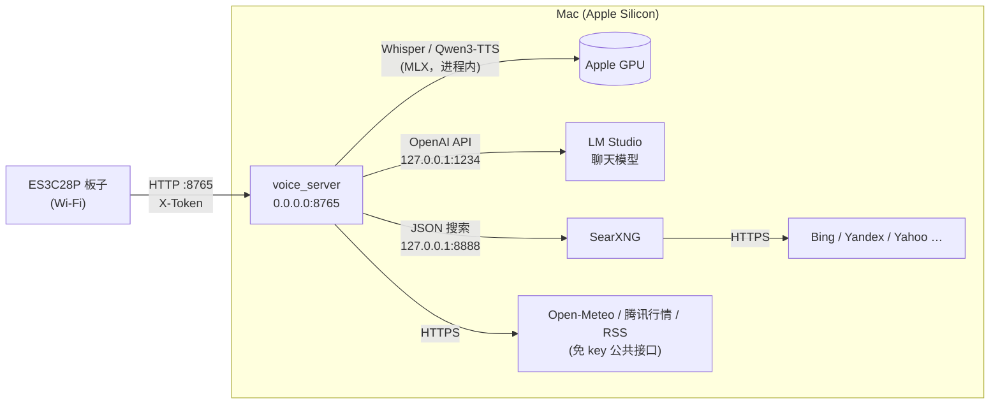
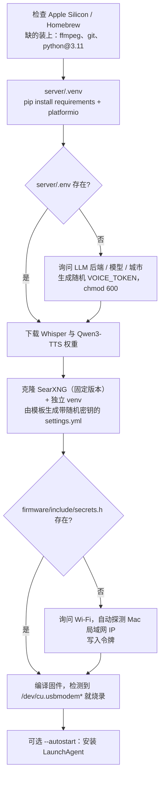
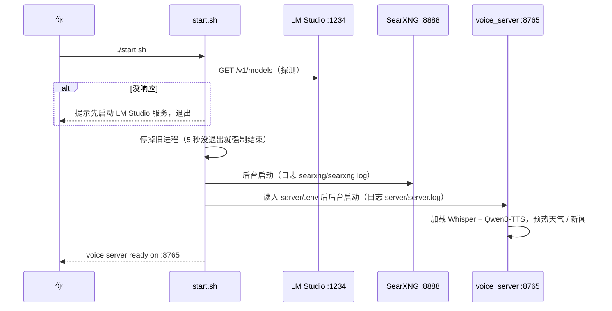

# 在 Mac 上启动后台服务

小奇的“大脑”都在 Mac 上：板子只负责录音、显示和播放。Mac 上需要同时跑三个服务：

| 服务 | 端口 | 作用 | 谁来启动 |
|---|---|---|---|
| **LM Studio**（或 Ollama） | `127.0.0.1:1234`（Ollama `11434`） | 大模型推理（OpenAI 兼容接口，支持工具调用） | 你手动打开，或设成登录自启 |
| **SearXNG** | `127.0.0.1:8888` | 本地元搜索引擎，给 `web_search` 工具用 | `./start.sh` |
| **voice_server** | `0.0.0.0:8765` | FastAPI：语音识别 → 大模型 → 语音合成，板子直接访问 | `./start.sh` |



只有 voice_server 对局域网开放；LM Studio 和 SearXNG 都只监听本机。

## 环境要求

- Apple Silicon Mac（M1 及以后）。Whisper 和 Qwen3-TTS 用 MLX 跑在 GPU 上，Intel Mac 不支持。
- macOS 14 及以上，[Homebrew](https://brew.sh)。
- 内存参考：语音模型（Whisper + Qwen3-TTS）约 4 GB；聊天模型另算，例如 Qwen3-30B-A3B 4bit 约 17 GB。**32 GB 及以上**比较从容；16 GB 的机器建议换小一些的聊天模型（如 Qwen3-8B），或设 `TTS_ENGINE=piper`。
- 磁盘：模型权重几 GB 到二十几 GB，取决于聊天模型。
- Mac 和板子在**同一个局域网**，板子只支持 **2.4 GHz** Wi-Fi。

## 第 1 步：准备大模型（LM Studio）

1. 安装 [LM Studio](https://lmstudio.ai)，在 Discover 里下载一个**支持工具调用**的聊天模型。推荐响应快的 MoE 模型，例如 `Qwen3-30B-A3B-Instruct-2507`。
2. 加载模型，打开左侧 **Developer** 页，点 **Start Server**（默认 `http://127.0.0.1:1234`）。
3. 检查：

   ```bash
   curl -s http://127.0.0.1:1234/v1/models | python3 -m json.tool
   ```

   返回的 `id` 就是后面要填的 `LLM_MODEL`。

如果用带思考（thinking）的模型，在 `server/.env` 里设 `LLM_REASONING_EFFORT=none`，回复能快 2–3 倍。

<details>
<summary>改用 Ollama</summary>

```bash
brew install ollama && ollama serve &
ollama pull qwen3:30b-a3b-instruct-2507-q4_K_M
```

`server/.env` 里设 `LLM_BACKEND=ollama`、`LLM_URL=http://127.0.0.1:11434`、`LLM_MODEL=qwen3:30b-a3b-instruct-2507-q4_K_M`。
</details>

## 第 2 步：一键安装

```bash
git clone https://github.com/syu-lk4b/esp32-chatbot-local.git xiaoqi
cd xiaoqi
./install.sh
```

脚本按顺序做这些事，可以重复运行，已有的配置不会被覆盖：



| 选项 | 作用 |
|---|---|
| `--no-flash` | 只编译不烧录（板子还没到时用） |
| `--skip-models` | 先不下载语音模型（第一次启动服务时会自动下载） |
| `--autostart` | 登录时自动运行 `start.sh` |
| `NONINTERACTIVE=1 WIFI_SSID=… WIFI_PASS=… ./install.sh` | 无人值守安装，其余项取默认值 |

生成的两个私密文件都已加入 `.gitignore`：`server/.env`（服务端配置和令牌）、`firmware/include/secrets.h`（Wi-Fi 和令牌）。

## 第 3 步：启动服务

```bash
./start.sh          # 启动 SearXNG + voice_server，等到就绪才返回
./start.sh stop     # 停止两者
```



检查是否正常：

```bash
curl -s http://127.0.0.1:8765/health          # {"ok":true,"llm":"openai:<模型>"}
curl -s "http://127.0.0.1:8888/search?q=test&format=json" | head -c 200
tail -f server/server.log                     # 每次对话的识别结果、工具调用、各环节耗时
```

第一次启动 macOS 可能弹窗问“是否允许 python 接受传入网络连接”，选**允许**，否则板子连不上。

### 不用 start.sh，手动启动

```bash
(cd searxng && ./run.sh)                                              # 终端 1
cd server && set -a && . ./.env && set +a && .venv/bin/python -m voice_server   # 终端 2
```

`server/Makefile` 里也有 `make dev`（前台跑服务）和 `make test`。

## 让它一直在线

板子按安装时记录的 IP 找 Mac，所以：

1. **固定 Mac 的 IP**：在路由器里给 Mac 做 DHCP 地址保留。IP 变了的话改 `firmware/include/secrets.h` 的 `CHAT_SERVER` 后重新烧录。
2. **登录自启**：`./install.sh --autostart` 安装 LaunchAgent（`~/Library/LaunchAgents/com.xiaoqi.voicechat.plist`）；LM Studio 在 Settings 里打开“登录时启动服务”。
3. **防止睡眠**：系统设置 → 电池 / 能源 → 接电源时“防止自动睡眠”；或命令行 `sudo pmset -c sleep 0`。只想临时保持唤醒用 `caffeinate -s`。

取消自启：

```bash
launchctl unload ~/Library/LaunchAgents/com.xiaoqi.voicechat.plist
rm ~/Library/LaunchAgents/com.xiaoqi.voicechat.plist
```

## 日志与数据

| 位置 | 内容 |
|---|---|
| `server/server.log` | 服务日志（含识别文字和回答，属于个人数据，已 gitignore） |
| `searxng/searxng.log` | 搜索服务日志 |
| `server/debug_clips/` | 识别为空的录音，用于排查；`DEBUG_CLIPS_DIR=` 置空可关闭 |

对话记忆只存在 voice_server 进程内存里（每台设备保留最近 8 轮，10 分钟没说话自动清空），不落盘，重启即清空；屏幕右上角 ⟳ 也能清空。
