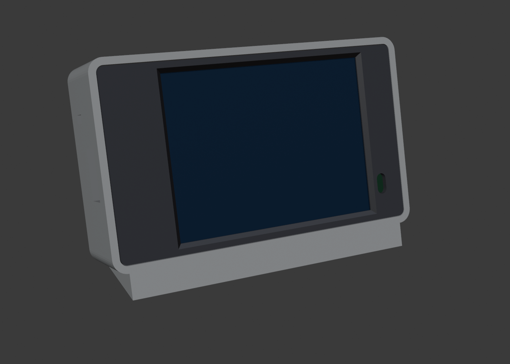

# ES3C28P desk enclosure

**English** | [中文](README.zh-CN.md)

A desk enclosure for XiaoQi (ES3C28P 2.8" display): a clean mini-monitor shape with the screen tilted back 15°, the speaker in the back, a wedge foot, and a bay for a 103450 Li-ion cell. Modeled parametrically in Blender; prints directly on a Bambu P1S.

<p>
  
  
</p>

## Files

| File | Notes |
|---|---|
| `stl/front_bezel.stl` | front bezel (oriented for printing: face down) |
| `stl/back_shell.stl` | back shell (oriented for printing: back down) |
| `slice/*.3mf` | sliced with P1S 0.4 nozzle + Bambu PLA Basic + 0.20mm Standard; open in Bambu Studio and send |
| `gen_enclosure.py` | parametric modeling script (all dimensions at the top) |
| `enclosure.blend` | assembly model (generated locally by the script, not committed) |
| `renders/` | preview images |

## Dimensions

Outside 91.0 × 55.0 × 26.0 mm (W × H × D, excluding the foot); the foot raises the front by 7 mm. Side walls 2.0 mm, back wall 2.5 mm.
Battery bay 34 × 50 × 10 mm (103450, e.g. a 2300 mAh cell), lead end up, near the BAT socket.
Printing: bezel ~10 min / 3.5 g, back shell ~67 min / 30 g, no supports.

Screws: M3×25 countersunk. The tip stops 1.0 mm short of the bezel face with 4.9 mm of thread engagement; the script re-checks this whenever dimensions change (it fails with `screw length mismatch`).

## Assembly

Parts: 4 × **M3×25 countersunk self-tapping screws** (type PA), 1 × **SS12D00 mini slide switch** (body ~8.6 × 3.6 × 3.5 mm), double-sided / foam tape.

1. Put the speaker into the pocket on the right of the back shell, cone facing the grille; fix it with a few dots of hot glue or foam tape
2. Put the battery into the left bay with double-sided tape; plug it into the board's **BAT** socket (**check polarity first**)
3. Power switch: cut the battery's **red (positive)** lead, solder the two ends to the switch's middle pin and one outer pin, and cover with heat shrink. Press the switch body into the slot above the USB-C opening on the left wall, with the lever through the small slot; add a drop of glue
4. Plug the speaker into the board's **SPEAKER** socket
5. Lay the bezel face down and drop the display module in screen-down, mounting holes over the bezel's posts
6. Close with the back shell (USB-C opening on the board's Type-C side) and drive the 4 screws from the back: through the shell's posts and the PCB into the bezel posts. Stop when snug; overtightening can crack the glass

The two slots on the back line up with RESET / BOOT; press them with a paper clip.

## Positions to verify on your print

These were placed from the official outline drawing plus a photo of the board's back (the photo shows the board upside down; USB-C is still on the left), and the openings are oversized. **Print the bezel first** (10 min) for a test fit:

- Mic hole: bezel lower right, `MIC_X, MIC_Z = (79.5, 10)`
- USB-C opening: centered at `USBC_Z = 23.1`, 14 mm tall
- RESET / BOOT slots: `BUTTON_X = 3.3`, RESET at z ≈ 11.6, BOOT at z ≈ 36.6

The power switch sits in the battery lead: **off** disconnects the battery entirely (no drain, but USB won't charge it); **on** lets USB power the board and charge the battery. Switch position: `SWITCH_Y, SWITCH_Z`.

If something is off, edit the parameters at the top of `gen_enclosure.py` and regenerate:

```bash
/Applications/Blender.app/Contents/MacOS/Blender -b -P gen_enclosure.py
```

The script checks that the meshes are watertight (`non_manifold_edges` must be 0) and that nothing collides with the PCB / battery / speaker proxies (`collisions none`).

## Reference

Board dimensions come from the outline drawing on page 13 of the [ES3C28P specification](https://www.lcdwiki.com/res/ES3C28P/ES3C28P_ES2N28P_Specification_V1.0.pdf): PCB 86 × 50 × 1.6 mm, 4 × Ø3.2 mounting holes (78 × 42 pitch), active area 58.05 × 43.6 mm, 4.3 mm front stack, tallest back-side component 4.7 mm.
